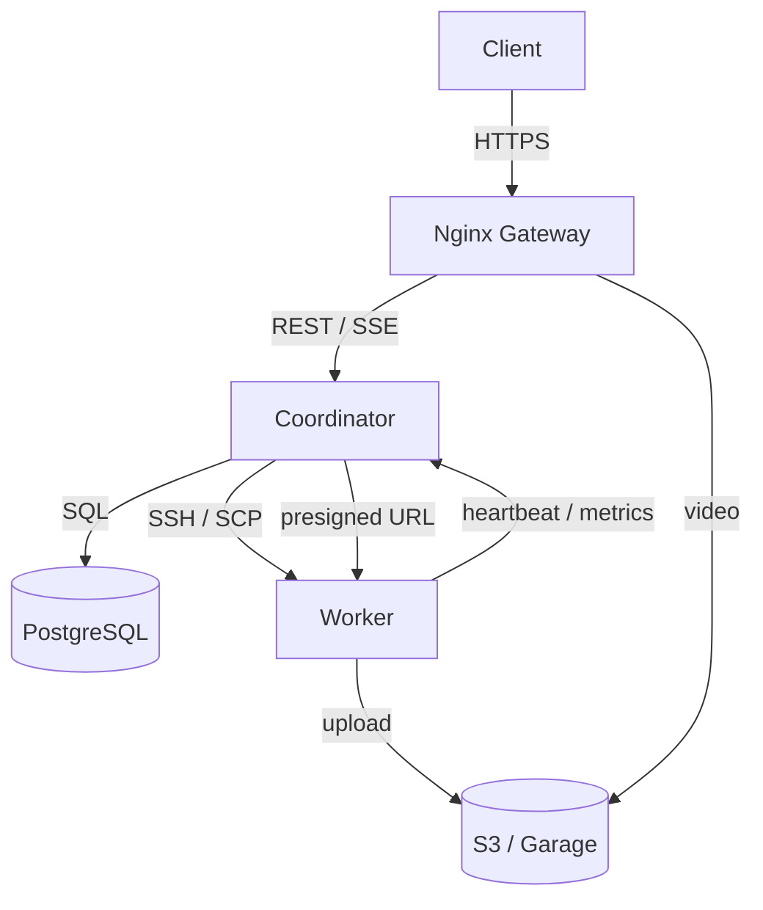

## Table of Contents

- [Features](#features)
- [Tech Stack](#tech-stack)
- [Architecture](#architecture)
- [Getting Started](#getting-started)
- [Configuration](#configuration)
- [Usage](#usage)
- [Testing](#testing)
- [Project Structure](#project-structure)
- [License](#license)

## Features

- User management with role-based access (viewer, operator, and administrator).
- JWT user authentication with refresh tokens.
- Worker provisioning via SSH:
    - SSH ed25519 key generation
    - Adding coordinator's public key to trusted keys
    - Setting up a restricted shell
    - Copying and running an agent
- Job scheduling by leasing ranges based on telemetry sent by workers.
- Real-time updates via SSE.
- Video storage using S3-compatible storage Garage.
- Interactive web-based SSH terminal.
- Video upload via presigned S3 URLs.
- Worker metrics collection via heartbeat.
- Password hashing with Argon2id.
- CSRF protection via Sec-Fetch-Site.

## Tech Stack

- **Languages:** Go (coordinator), Python (agent)
- **HTTP framework:** Gin
- **Database driver:** pgx/v5
- **Storage:** S3 (Garage)
- **Auth:** JWT, HTTP Message Signatures (RFC 9421), Argon2id
- **Real-time:** SSE, WebSockets (gorilla/websocket)
- **Caching:** hashicorp/golang-lru
- **Infrastructure:** Docker, Nginx

## Architecture


- **Coordinator** - REST API, manages users, workers, jobs, videos. Distributes identifier ranges to workers via leases.
- **Worker** - remote agent, receives ranges, downloads videos, uploads to S3, reports metrics.

## Getting Started

### Prerequisites

- Docker and Docker Compose

### Installation

```bash
git clone https://github.com/LammoGit/kinescope-scrapper.git
cd kinescope-scrapper
cp .env.example .env
# Add certificate and key files
docker compose up -d --build
```
The Nginx gateway serves HTTPS on port `9000`.

## Configuration

Copy `.env.example` to `.env` and fill in the values.

| Variable | Description |
|----------|-------------|
| `POSTGRES_USER` | PostgreSQL user |
| `POSTGRES_PASSWORD` | PostgreSQL password |
| `POSTGRES_DB` | PostgreSQL database name |
| `S3_ENDPOINT` | S3-compatible endpoint URL |
| `S3_ACCESS_KEY` | S3 access key |
| `S3_SECRET_KEY` | S3 secret key |
| `S3_BUCKET` | S3 bucket name |
| `RPC_SECRET` | Shared secret for internal RPC |
| `JWT_SECRET` | JWT signing secret |
| `ADMIN_USERNAME` | Bootstrap administrator username |
| `ADMIN_EMAIL` | Bootstrap administrator email |
| `ADMIN_PASSWORD` | Bootstrap administrator password |

## Usage

### Register and log in

```bash
curl -k -X POST https://localhost:9000/api/register \
  -H 'Content-Type: application/json' \
  -d '{"username":"username","email":"email@example.com","password":"password"}'

export TOKEN=$(curl -sk https://localhost:9000/api/login \
  -H 'Content-Type: application/json' \
  -d '{"email":"email@example.com","password":"password"}' \
  | jq -r .access_token)
```

### Register a worker

```bash
curl -k -X POST https://localhost:9000/api/workers/register \
  -H "Authorization: Bearer $TOKEN" \
  -H 'Content-Type: application/json' \
  -d '{"name":"worker-1","host":"192.168.1.10","ssh_port":22,"ssh_user":"admin","threads":4,"storage_path":"/var/lib/worker","min_free_space_gb":10}'
```

### Subscribe to real-time updates
```bash
curl -k -N https://localhost:9000/api/stream/workers/updates \
  -H "Authorization: Bearer $TOKEN"
```

## Testing

```bash
cd coordinator
go test ./...
go test ./... -race -cover
```

## Project Structure

```
cmd/coordinator/   - entry point
internal/api/      - HTTP handlers, middleware
internal/services/ - business logic
internal/domain/   - domain models
internal/storage/  - data layer (PostgreSQL)
internal/utility/  - shared utilities (errors, patch)
pkg/sse/           - SSE pub/sub hub
```

## License
Distributed under the MIT License. See LICENSE for more information.
